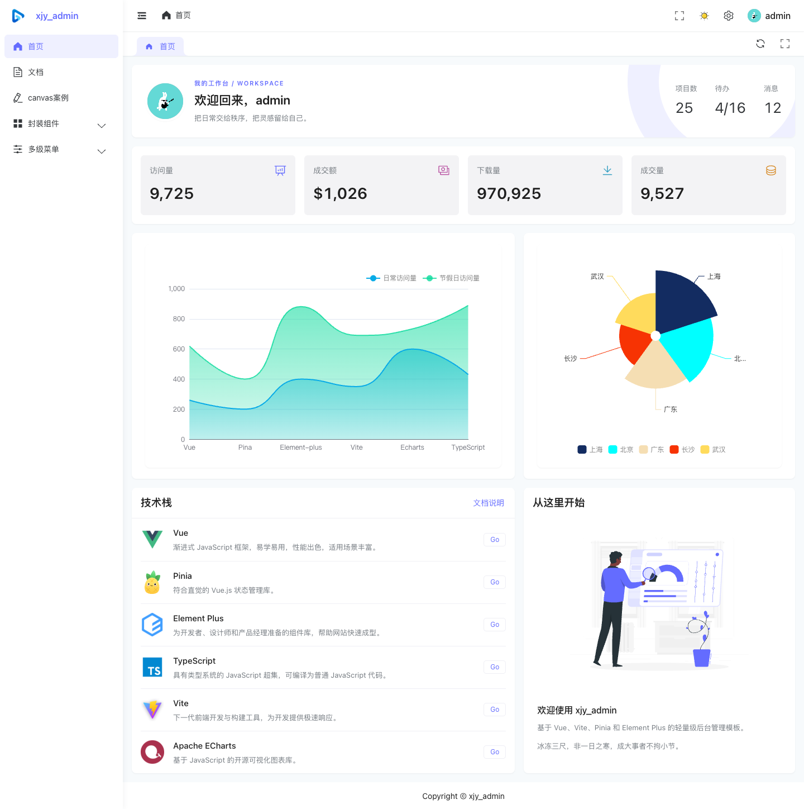
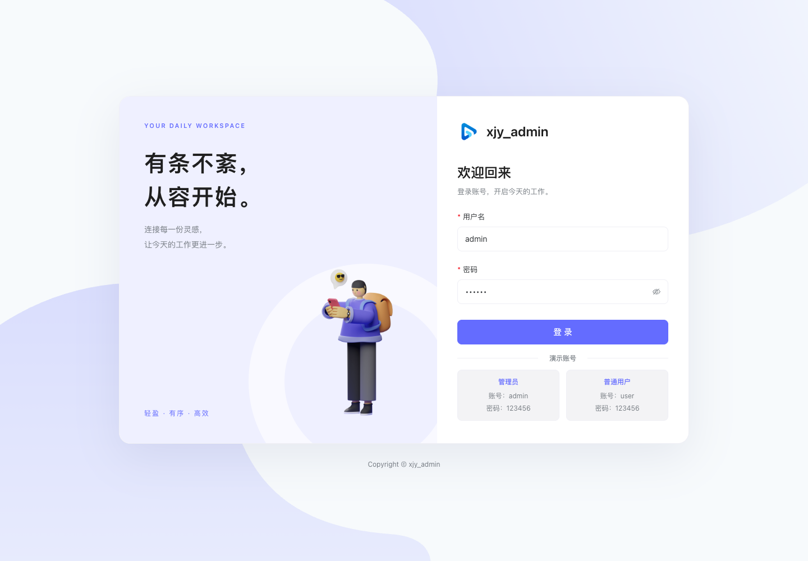
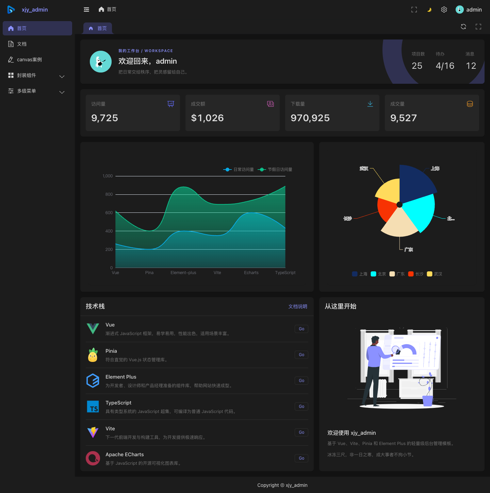
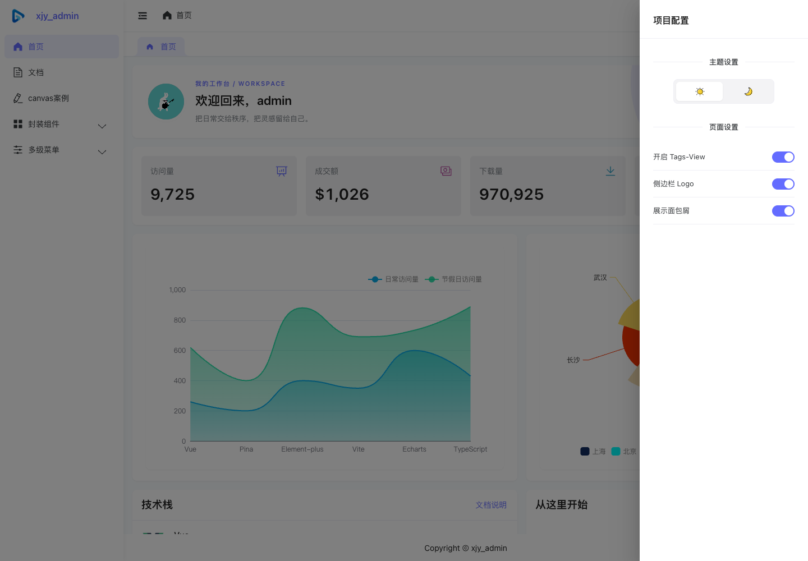
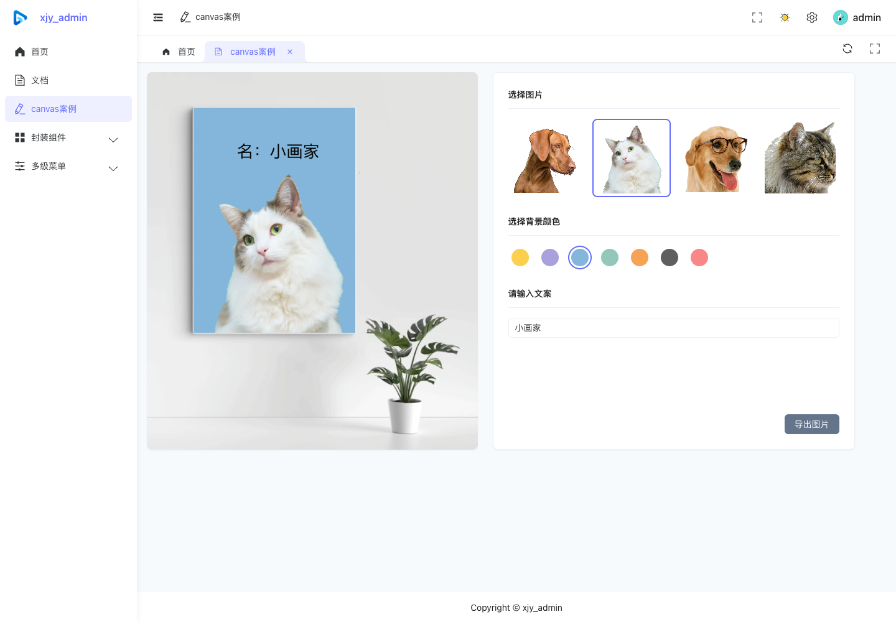
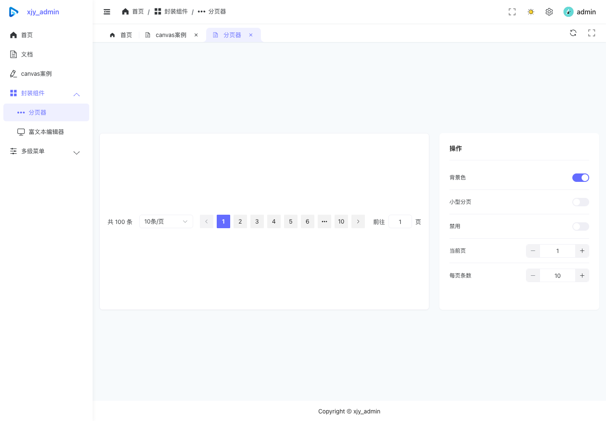
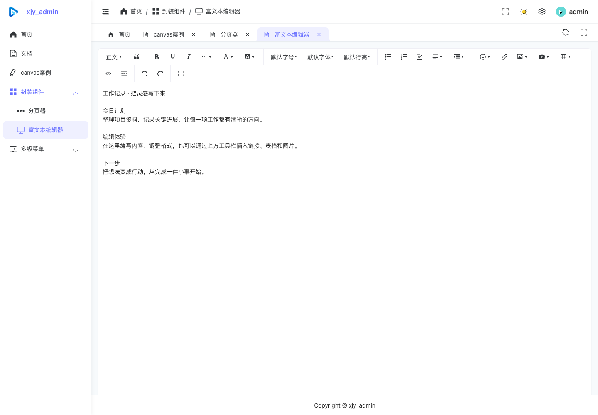
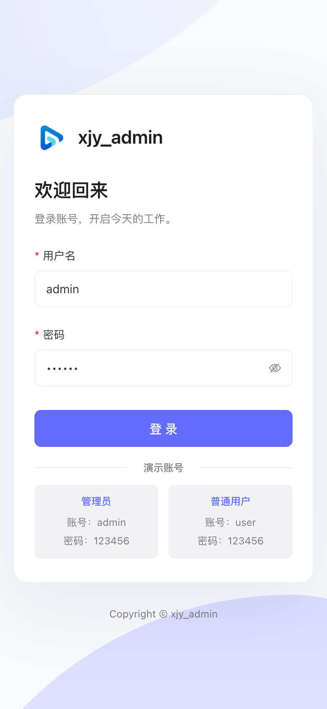
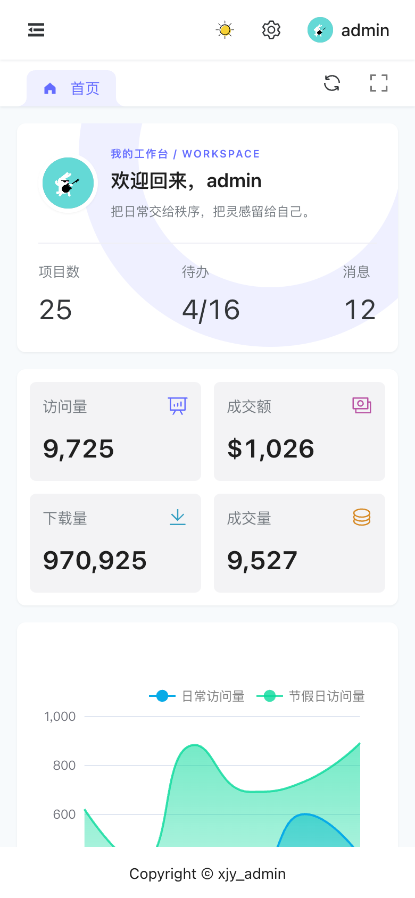
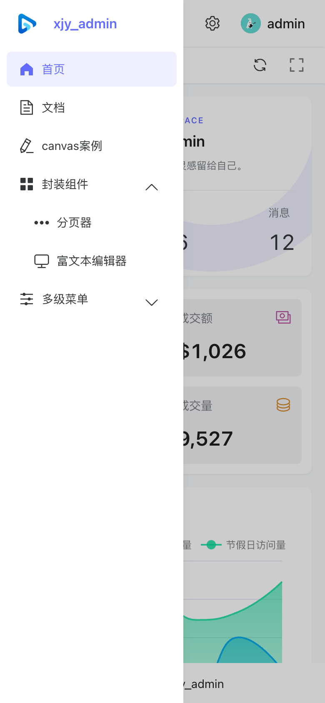

<div align="center">
  
  <h1>xjy_admin</h1>
  <p>轻量、清晰、开箱即用的 Vue 3 后台管理模板</p>
  <p>
    
    
    
    
  </p>
  <p>
    <a href="#快速开始">快速开始</a> ·
    <a href="#功能概览">功能概览</a> ·
    <a href="#页面预览">页面预览</a> ·
    <a href="#项目结构">项目结构</a> ·
    <a href="#配置说明">配置说明</a>
  </p>
</div>

基于 Vue 3、Element Plus 和 TypeScript 构建，内置登录、权限菜单、工作台、主题设置及常用组件示例。项目使用 Mock 数据，可独立启动，适合后台页面原型、学习实践和管理系统项目起步。



## 功能概览

| 功能        | 说明                                                       |
| ----------- | ---------------------------------------------------------- |
| 登录与权限  | 管理员、普通用户两种演示账号，按用户权限生成菜单与动态路由 |
| 导航布局    | 侧栏展开与收起、多级菜单、面包屑、页面标签及页面刷新       |
| 工作台      | 欢迎区、概览统计、ECharts 折线图与饼图、技术栈入口         |
| 主题与设置  | 浅色 / 深色切换，设置抽屉可控制标签栏、Logo 和面包屑       |
| 移动端      | 小屏抽屉导航、单列页面布局及图表、表单的响应式适配         |
| Canvas 案例 | 图片选择、背景配色、文案绘制与图片导出                     |
| 组件示例    | 分页器参数配置、富文本编辑器                               |
| 基础体验    | 路由加载进度、页面缓存、404 页面                           |

首页统计与图表内容用于界面演示。

## 快速开始

### 环境要求

- Node.js **22.13+（22.x）或 24+**
- pnpm **12.14.0**

版本约束见 [package.json](package.json)，完整依赖版本由 [pnpm-lock.yaml](pnpm-lock.yaml) 固定。

### 安装与启动

在项目根目录执行：

```bash
pnpm install --frozen-lockfile
pnpm dev
```

浏览器访问 <http://localhost:9000>。

### 演示账号

| 角色     | 账号    | 密码     | 可访问内容                                   |
| -------- | ------- | -------- | -------------------------------------------- |
| 管理员   | `admin` | `123456` | 首页、文档、Canvas、分页器、富文本及多级菜单 |
| 普通用户 | `user`  | `123456` | 首页、文档、富文本编辑器                     |

账号与权限数据位于 [src/mock/index.ts](src/mock/index.ts)。

## 常用命令

| 命令              | 用途                                       |
| ----------------- | ------------------------------------------ |
| `pnpm dev`        | 启动开发服务，默认端口 `9000`              |
| `pnpm type-check` | 检查 TypeScript 源码与 Vue 模板类型        |
| `pnpm lint`       | 检查脚本和 Vue 模板                        |
| `pnpm lint:style` | 检查 CSS、SCSS 与 Vue 样式                 |
| `pnpm build`      | 执行类型检查并生成生产构建                 |
| `pnpm check`      | 执行脚本检查、样式检查、类型检查与生产构建 |
| `pnpm preview`    | 本地预览生产构建，默认端口 `4173`          |

## 页面预览

以下截图采集于 **2026-10-20**，来自当前项目的本地生产构建。桌面视口宽度为 `1440px`，移动端视口为 `390 × 844px`；图片保存在 [docs/screenshots](docs/screenshots/)。

### 桌面端

<details>
<summary>登录页面</summary>

欢迎区与登录表单采用双栏布局，保留项目 Logo、插画和演示账号提示。



</details>

<details>
<summary>深色工作台</summary>

深色主题覆盖导航、标签栏、卡片和图表容器。



</details>

<details>
<summary>项目配置</summary>

通过设置抽屉切换主题，并控制标签栏、侧栏 Logo 和面包屑的显示。



</details>

<details>
<summary>Canvas 图片绘制</summary>

选择图片、背景色并输入文案，即可预览组合效果并导出图片。



</details>

<details>
<summary>分页器</summary>

通过配置项体验分页器的尺寸、背景、禁用状态及页码交互。



</details>

<details>
<summary>富文本编辑器</summary>

基于 WangEditor，提供内容编辑与常用排版工具。



</details>

### 移动端

小于 `640px` 时，侧栏切换为带遮罩的抽屉导航；登录页收为单列，工作台卡片与图表按屏幕宽度重新排列。

<table>
  <thead>
    <tr>
      <th>登录</th>
      <th>工作台</th>
      <th>抽屉导航</th>
    </tr>
  </thead>
  <tbody>
    <tr>
      <td></td>
      <td></td>
      <td></td>
    </tr>
  </tbody>
</table>

## 技术栈

| 类别       | 技术                     | 当前版本        |
| ---------- | ------------------------ | --------------- |
| 应用与路由 | Vue / Vue Router         | 3.5.44 / 4.6.4  |
| 组件与图标 | Element Plus / Icons Vue | 2.14.7 / 2.3.2  |
| 状态管理   | Pinia                    | 2.3.1           |
| 开发语言   | TypeScript               | 5.5.4           |
| 构建工具   | Vite / Vue 插件          | 7.3.7 / 6.0.10  |
| 原子样式   | UnoCSS                   | 66.11.0         |
| 数据可视化 | ECharts                  | 5.6.0           |
| 富文本     | WangEditor / Vue 适配器  | 5.1.23 / 5.1.12 |
| 请求与模拟 | Axios / MockJS           | 1.20.0 / 1.1.0  |

代码质量工具包括 ESLint、Stylelint、Prettier 和 vue-tsc，具体配置位于项目根目录。

## 项目结构

```text
xjy_admin/
├── docs/
│   ├── screenshots/        # 当前界面截图
│   └── licenses/           # 第三方资源许可
├── public/                 # 静态资源与加载页
├── src/
│   ├── api/                # 接口与相关类型
│   ├── assets/             # 图片、图标等资源
│   ├── components/         # 公共组件
│   ├── config/             # 站点配置与公共样式
│   ├── mock/               # 演示接口与权限数据
│   ├── router/             # 常量路由与权限路由
│   ├── stores/             # 用户、布局与主题状态
│   ├── styles/             # 全局样式、主题与动效
│   ├── utils/              # 请求、存储等工具
│   ├── views/              # 登录、布局及功能页面
│   ├── permission.ts       # 路由访问控制
│   └── main.ts             # 应用入口
├── .env.development        # 开发环境变量
├── .env.production         # 生产环境变量
├── package.json            # 依赖与脚本
├── pnpm-lock.yaml          # 依赖锁文件
├── uno.config.ts           # UnoCSS 配置
└── vite.config.ts          # 构建与开发代理配置
```

## 配置说明

### 站点与界面

| 配置内容                         | 文件位置                                                       |
| -------------------------------- | -------------------------------------------------------------- |
| 项目名称、Logo、默认界面选项     | [src/config/setting.ts](src/config/setting.ts)                 |
| 主题颜色、间距、圆角、侧栏宽度   | [src/styles/theme.scss](src/styles/theme.scss)                 |
| 主题过渡、侧栏动效时长、浮层层级 | [src/styles/motion.scss](src/styles/motion.scss)               |
| Element Plus Sass 主题           | [src/styles/element/index.scss](src/styles/element/index.scss) |
| 全局样式入口                     | [src/styles/index.scss](src/styles/index.scss)                 |
| 布局与响应式样式                 | [src/views/Layout/index.scss](src/views/Layout/index.scss)     |

基础过渡时长通过 `--app-motion-duration` 统一配置，默认为 `300ms`。桌面侧栏使用 Element Plus 原生折叠动画，侧栏时长由 `--app-sidebar-duration` 控制。设置抽屉的层级高于导航与菜单弹层。

### 菜单与权限

路由定义位于 [src/router/route.ts](src/router/route.ts)，通过 `meta.title`、`meta.icon` 和 `meta.isShow` 配置菜单名称、图标及显示状态。权限菜单由用户信息与动态路由配置共同生成，入口见 [src/permission.ts](src/permission.ts) 和 [src/stores/modules/user.ts](src/stores/modules/user.ts)。

### Mock 与接口

当前在 [src/main.ts](src/main.ts) 中加载 Mock 数据，登录和用户信息接口定义于 [src/mock/index.ts](src/mock/index.ts)，请求封装位于 [src/utils/request.ts](src/utils/request.ts)。

- `VITE_BASE_URL`：接口请求前缀，默认 `/api`。
- `VITE_URL`：开发代理的目标地址，在 [vite.config.ts](vite.config.ts) 中使用。

接入后端时，根据实际服务调整 Mock 入口、环境变量及接口返回结构；生产环境的接口转发由部署服务器配置。

## 构建与部署

```bash
# 完成检查并生成生产构建
pnpm check

# 本地预览 dist
pnpm preview
```

构建产物输出到 `dist/`。项目使用 Hash 路由，静态部署时上传 `dist/` 内的完整文件，并保留资源目录结构。

## 许可证

项目采用 [Mulan PSL v2](LICENSE)。随附资源的独立许可保存在 [docs/licenses](docs/licenses/)。
