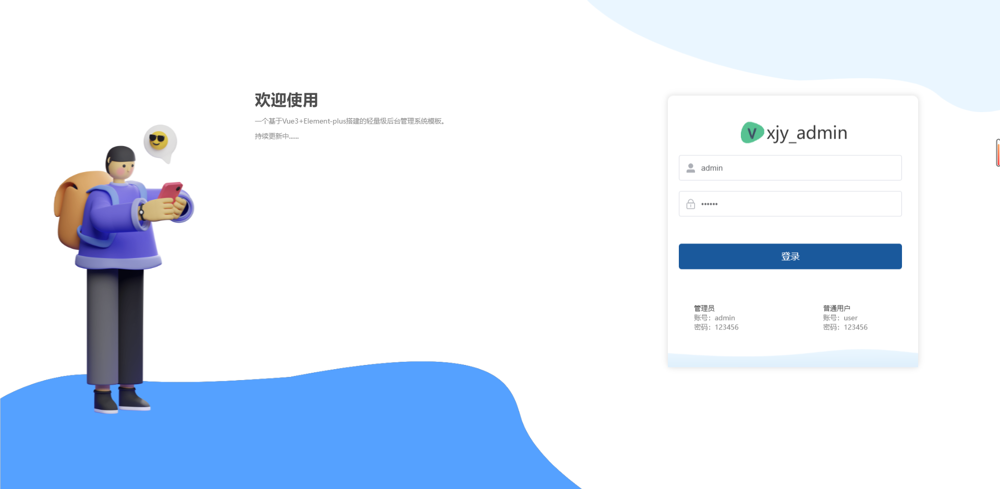
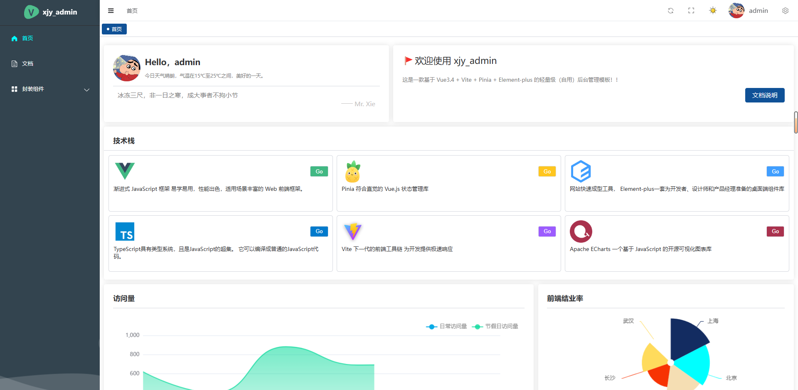

 <div align="center">
  
 </div>

 <h1 align="center" style="margin: 30px 0 30px;display: flex;align-items: center;font-weight: bold;">
 xjy_admin
 </h1>

一个基于Vue3+Element-plus+TypeScript搭建的轻量级（通用）后台管理系统模板，本模板相比其他后台管理模板，集成的插件和封装功能比较少，简单，通俗易懂。

<div align="center">
    
    
    
    
    
    
    
</div>

## 本地开发

使用 Node.js **22.13+（22 LTS）或 24+**、pnpm **12.14.0**。版本约束写在 `package.json`，依赖版本由 `pnpm-lock.yaml` 固定。

```bash
pnpm install --frozen-lockfile
pnpm dev
```

开发地址为 <http://localhost:9000>。默认演示账号为 `admin / 123456`，普通用户为 `user / 123456`。

```bash
pnpm type-check   # 检查源码和 Vue 模板类型
pnpm lint         # 检查 TS、Vue 脚本和模板，不自动改代码
pnpm lint:style   # 检查 SCSS、Vue 样式和加载页 CSS
pnpm build        # 先检查类型，再生成 dist
pnpm check        # 执行以上检查和生产构建
pnpm preview     # 预览生产构建，默认端口 4173
```

## 依赖与样式维护

本次适配保留 Vue 3 + Element Plus 的现有架构，更新 Vite、UnoCSS、Vue 类型工具与 ESLint，并清理未使用的 webpack/Sass loader、重复插件及不兼容的 Stylelint 配置。ESLint 使用 flat config；检查与自动修复命令分开，避免检查时改动业务脚本。

| 组合 | 固定版本 | 兼容说明 |
| --- | --- | --- |
| Vue / Vue Router | 3.5.44 / 4.6.4 | 同一套 Vue 3.5 运行时 |
| Vite / Vue 插件 | 7.3.7 / 6.0.10 | 匹配构建插件和现代 Sass 接口 |
| Pinia / 持久化插件 | 2.3.1 / 3.2.3 | 兼容现有 `paths` 配置；保留原有插件注册方式 |
| TypeScript / vue-tsc | 5.5.4 / 3.3.13 | 保留现有 JS 表达式，避免引入需要修改运行代码的新语法诊断 |
| ESLint / Vue 插件 | 10.13.0 / 10.11.1 | 配合 typescript-eslint 8 和 Vue 解析器 10 |
| Stylelint / Vue 配置 / HTML 解析器 | 16.26.1 / 2.0.0 / 2.0.0 | 移除已失效的格式规则与 peer 冲突 |

源码仅修正类型标注、类型导入及模板兼容属性，业务 JS 与 Vue 脚本逻辑保持一致。Canvas 案例补齐父路由 `canvas-layout` 名称和管理员的对应路由权限项，以恢复现有权限过滤下的菜单与页面；绘制、图片选择、颜色、文案与导出逻辑保持原样。`skipLibCheck` 仅跳过第三方声明文件的检查，项目源码与 Vue 模板仍由 `vue-tsc` 检查。后续升级 TypeScript 或 Pinia 大版本前，需要先评估现有业务写法与插件 API。

管理布局参考 [Soybean Admin](https://github.com/soybeanjs/soybean-admin/blob/main/src/theme/settings.ts) 的默认主题：`#646cff` 主色、浅灰页面背景、56px 页头、220px / 64px 侧栏、Chrome 风格标签和 8px 卡片圆角。登录页保留本项目的 Logo 和人物素材，采用欢迎区与登录表单的双栏布局；首页采用简洁的工作台概览，保留原有图表和技术栈入口。首页概览中的统计数字为静态演示内容，图表数据、交互、登录和权限逻辑均保持原样。

主题颜色集中在 `src/styles/theme.scss`，Element Plus 的 Sass 主题位于 `src/styles/element/index.scss`。`src/styles/motion.scss` 统一管理 `--app-motion-duration`（默认 `300ms`）、`--app-motion-easing` 和浮层层级。桌面侧栏恢复 Element Plus 原生折叠动画，`--app-sidebar-duration` 默认跟随基础时长，`--app-sidebar-easing` 使用与原生宽度过渡相同的 `ease-in-out`；内容区与 Logo 同步。主题颜色通过 CSS `@property` 在根节点统一插值，组件直接使用同一帧的颜色，避免嵌套动画造成不同步；主题切换保持 `300ms`，尊重系统的减少动态效果设置。面包屑使用淡入，不再横向滑入。

桌面使用一个 `el-menu`，绑定现有的 `flag` 并开启 `collapse-transition`，由 Element Plus 控制宽度和文字切换，不再使用两份固定菜单做淡入淡出。子菜单使用 `flow-root` 隔离外边距，行间距放在菜单项容器上，避免原生高度动画切换 `overflow` 时文字上下跳动。现有路由配置、菜单点击与业务脚本保持原样。小于 `640px` 时，导航切换为带遮罩的抽屉，点击菜单后自动收起；首页图表改为单列，统计卡片按宽度排列，登录页收为单列表单。设置抽屉挂载到 `body`，其遮罩和面板的层级高于桌面导航、移动端导航与菜单弹层。太阳、月亮和设置齿轮保留本项目的原始图标。参考项目 SVG 与标签几何图形的许可说明见 `docs/licenses/soybean-admin.txt`。

Element Plus 的完整主题只编译一次，组件自动导入不再重复插入样式。全局 Sass 与布局样式改用 `@use`，避免旧 Sass API 和 `@import` 的弃用提示。

生产构建仍可能提示 MockJS 内部使用 `eval`，以及 ECharts / 编辑器打包体积较大；这些是既有库的非阻断提示，构建会正常生成 `dist`。后续若要替换 MockJS 或对图表进行按需导入，需要单独调整业务脚本。

## 特性

- 前端：Vue3+Element-plus+Vite
- 后端：无后端（项目采用mockjs模拟数据）
- 项目基本结构：


## 预览


xjy_admin提供了以下演示和文档资源:

- 账户信息：(管理员)账号：admin，密码：123456
- 账户信息: (普通用户) 账号：user，密码：123456
- 在线地址：[xjy_admin](https://dragon-xjy.atomgit.net/xjy-admin/#/home)
- 文档地址：[xjy_admin](https://juejin.cn/post/7380283122489081856)


## 效果展示





